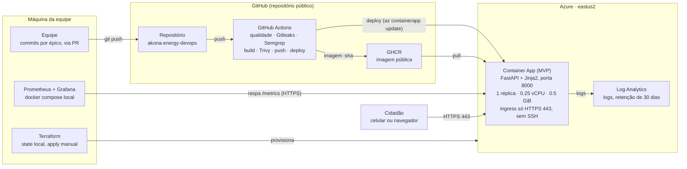

# Arquitetura do Akona Energy

> Este documento descreve a arquitetura definida no plano. Em 11/11/2026 só a aplicação (E1) estava pronta; o restante está em construção. Veja "Situação dos componentes" no fim.

O código só vira imagem no GitHub Container Registry (GHCR) se passar pelos testes e pelos três scanners (Gitleaks, Semgrep e Trivy). O deploy troca a imagem do Container App, que é a única parte exposta ao cidadão, e só por HTTPS.

## Componentes

| Componente | Onde roda | Papel |
| --- | --- | --- |
| Aplicação MVP | Container App na Azure | FastAPI + Jinja2, sem JavaScript, com dados sintéticos em `app/data/mock.json`. Expõe as páginas, `/health` e `/metrics` na porta 8000 |
| Repositório | GitHub, público | Código e documentação; o Dockerfile, o workflow e o Terraform entram com o E2, o E3 e o E4 |
| GitHub Actions | Runners do GitHub | Pipeline `devsecops.yml`: qualidade (ruff e pytest), Gitleaks, Semgrep, build, Trivy, push no GHCR e deploy |
| GHCR | GitHub | Guarda a imagem `ghcr.io/joaolucasyudi/akona-energy-devops`, marcada pelo SHA do commit |
| Terraform | Máquina da equipe | Cria o resource group, o Log Analytics, o ambiente e o Container App. O state fica local, fora do Git |
| Log Analytics | Azure | Recebe os logs do Container App, com retenção de 30 dias e cota diária de 0,5 GB |
| Prometheus + Grafana | Máquina da equipe | Raspam `/metrics` da URL pública e mostram as 4 métricas de ouro, com uma regra de alerta |

## Por que não existe porta administrativa aberta

Não há VM, NSG nem IP público de máquina. O Container Apps só expõe o ingress HTTPS (443), gerenciado pela Azure. Não existe SSH nem RDP para abrir, e o deploy usa a API da Azure, não acesso à máquina.

## Fluxo de uma mudança

1. A equipe envia um commit para um branch e abre um PR para a `main`.
2. A cada push, o workflow roda qualidade, Gitleaks e Semgrep. Se os três passarem, faz o build da imagem e roda o Trivy.
3. Só na `main`, a imagem aprovada é publicada no GHCR com a tag do SHA, e o job `deploy` atualiza o Container App para essa imagem e confere `/health`.
4. O Prometheus local raspa `/metrics` da URL pública, e o Grafana mostra o dashboard e avalia o alerta.

## Situação dos componentes

O diagrama descreve a arquitetura definida no plano (`docs/plano-devops.md`). Em 11/11/2026, só a aplicação estava pronta.

| Componente | Épico | Situação em 11/11/2026 |
| --- | --- | --- |
| Aplicação MVP | E1 | Pronta na `main` |
| Dockerfile e docker compose | E2 | Em construção |
| Workflow DevSecOps e push no GHCR | E3 | Em construção |
| Terraform (Container App, Log Analytics) | E4 | Em construção |
| Deploy contínuo | E5 | Em construção |
| Prometheus, Grafana e alerta | E6 | Em construção |

**Pendente (E8b):** atualizar esta tabela, incluir a URL pública do MVP (FQDN do Container App) e exportar o diagrama como `docs/evidencias/00-arquitetura.png` para o PDF.
