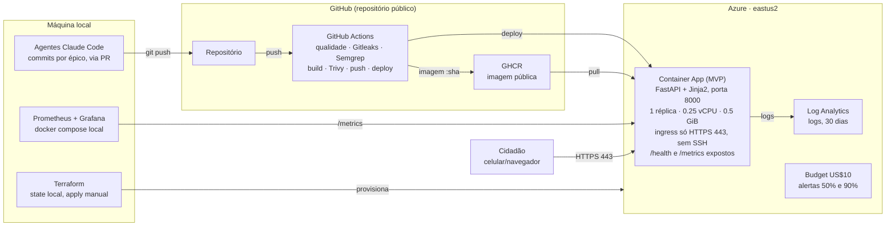
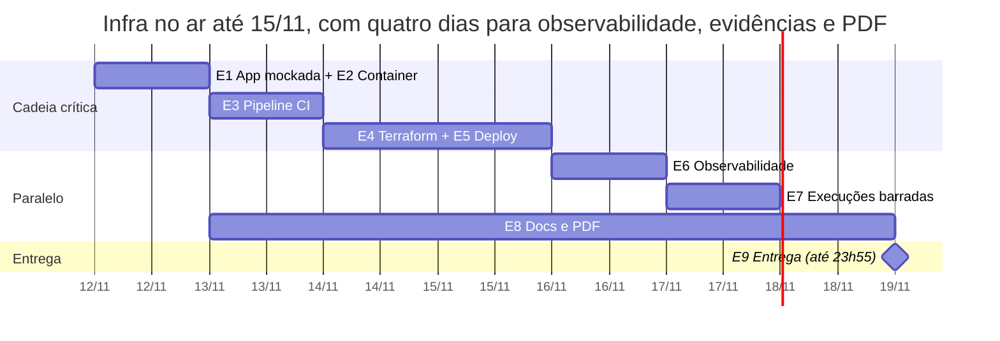

# Plano de Ação — GS 2026.2 · Secure DevOps Tools & Cloud Computing (Deploy Blindado)

10/11/2026 · João Lucas · revisado em 11/11/2026

## Contexto, escopo e critérios

O objetivo é entregar até 19/11/2026 às 23h55 o "Deploy Blindado" da disciplina Secure DevOps Tools & Cloud Computing (prof. Gabriel Arcanjo), valendo 14 pontos. O plano está organizado em 9 épicos, para serem quebrados em specs (issues no Linear) e executados por agentes Claude Code.

**Dentro do escopo:** uma aplicação MVP simples com dados mockados, empacotada em container, publicada na Azure via Terraform, com pipeline DevSecOps no GitHub Actions, observabilidade com Prometheus e Grafana, e a documentação e o PDF exigidos.

**Fora do escopo:** entregáveis das outras seis disciplinas (GenAI, Big Data, BI, Visão, RPA, Maker Lab), banco de dados, integração com LLM ou Databricks, e dados reais de cidadãos.

**Entregáveis exigidos pelo enunciado:** repositório público com Dockerfile, workflow e Terraform; URL pública do MVP; PDF com arquitetura, evidências (prints) e custo; Ficha Técnica do MVP no README. Formato: PDF único com links clicáveis, um envio por equipe, no portal da disciplina.

| Bloco | Pontos | Critério literal do enunciado | Épicos |
| --- | --- | --- | --- |
| Container | 2,0 | Dockerfile enxuto, usuário não root, sem segredo na imagem, stack subindo com docker compose | E1, E2 |
| IaC | 3,0 | Nuvem criada por Terraform, state e .tfvars fora do repo, porta admin nunca aberta para 0.0.0.0/0 | E4 |
| Pipeline DevSecOps | 4,0 | GitHub Actions com build, Gitleaks, Semgrep e Trivy a cada push, segredos em GitHub Secrets, deploy automático; mostrar uma execução barrada e a corrigida | E3, E5, E7 |
| Observabilidade | 3,0 | Dashboard com as 4 métricas de ouro e um alerta disparado; Prometheus e Grafana podem rodar local apontando para o MVP publicado | E6 |
| Documentação | 2,0 | Diagrama da arquitetura, responsabilidade compartilhada, onde ficam os dados pessoais (LGPD), estimativa de custo, README reproduzível | E8 |

Regras gerais da GS que também valem: equipe de até 5 alunos, repositório e URL públicos e funcionando durante a correção (até uma semana após 19/11), e nome completo e RM de todos os integrantes.

## Decisões fechadas

Todas as decisões abaixo foram alinhadas em 10/11 e são premissas fixas para as specs. Mudar qualquer uma exige revisar os épicos afetados.

| # | Tema | Decisão | Motivo |
| --- | --- | --- | --- |
| D1 | Escopo | Somente entregáveis de Secure DevOps; MVP existe apenas para ser empacotado, publicado e monitorado | Pedido explícito |
| D2 | Stack do app | Python 3.12, FastAPI e Jinja2, sem JavaScript | Uma imagem só, sem build de Node, SSR acessível e leve |
| D3 | Dados | Mock em JSON versionado no repo, com chamados e cidadãos fictícios; sem banco, sem autenticação, sem formulário que grava | Banco e login reais custariam 2 a 3 dias, dobrariam o custo e criariam uma porta de banco para justificar no critério de IaC, sem valer ponto |
| D4 | Nuvem | Azure for Students como primeira opção, região eastus2; a assinatura pessoal paga é o plano B se o teste de viabilidade (H2b) falhar | Sem custo no cartão; o teste antecipa bloqueios de região, provider e service principal |
| D5 | Computação | Azure Container Apps (plano consumption), 1 réplica fixa (min = max = 1) | Sem VM, sem SSH/RDP: nenhuma porta admin existe. Réplica fixa mantém métricas coerentes |
| D6 | Registry | GitHub Container Registry (ghcr.io), imagem pública, nome sempre em minúsculas (`ghcr.io/joaolucasyudi/akona-energy-devops`) | Grátis, sem credencial de pull na Azure; o Docker rejeita maiúsculas no nome da imagem e o usuário do GitHub é `JoaoLucasYudi` |
| D7 | IaC | Terraform (provider azurerm 4.x) aplicado manualmente; pipeline só troca a imagem; `ignore_changes` na imagem | Pipeline com menos permissão e sem acesso ao state |
| D8 | State | Local, ignorado no `.gitignore`, junto com `*.tfvars` | Escolha da equipe; atende "state fora do repo" |
| D9 | Auth CI → Azure | Service principal com segredo, papel Contributor restrito ao resource group, JSON em `AZURE_CREDENTIALS` | Mais simples numa conta pessoal |
| D10 | Observabilidade | Prometheus + Grafana locais via docker compose, raspando `/metrics` da URL pública sem autenticação (não expõe dados sensíveis) | Permitido pelo enunciado; custo zero |
| D11 | Alerta | Regra de alerta do Grafana; evidência = print em estado Firing | Sem canal de notificação |
| D12 | Execução barrada | Uma execução barrada pelo Semgrep e a corrigida | É o que o enunciado pede |
| D13 | Repositório | Repositório público dedicado ao MVP e à entrega de DevOps | Separado dos repos das outras disciplinas |
| D14 | Custos | Budget de US$10 no resource group criado pelo portal (se a assinatura permitir budgets; na Students, acompanhar o crédito no portal de patrocínio); `terraform destroy` após a correção | Estimativa de US$5–7 no período 14/11–01/12, a confirmar na calculadora; o alerta de 50% deve disparar e isso é esperado |
| D15 | Specs | Uma issue por épico no Linear (time `JOA`, projeto `gs-devops`, JOA-22 a JOA-38), com E6 e E8 divididos em duas (parte que roda cedo e parte que depende da produção) e as tarefas humanas H1, H2, H2b, H3, H4 e H7 como issues próprias; H5 está dentro do E5, H6 dentro do E6b e H8 é o E9. O bloqueio real entre issues é o do Linear | Preferência do usuário; a divisão existe para permitir worktrees em paralelo |
| D16 | Actions | Oficiais (`actions/*`, `docker/*`, `azure/*`) por tag de versão maior; terceiros (Trivy, Gitleaks) por SHA completo do commit, com a versão em comentário | Tags são mutáveis; fixar por SHA protege contra comprometimento do repositório da action |
| D17 | PDF | `relatorio.md` → HTML → PDF pelo Chrome headless; diagrama Mermaid exportado como PNG | Sem LaTeX; preserva links clicáveis |

## Arquitetura alvo e estrutura do repositório

O código sai das sessões dos agentes, passa pelo pipeline e só vira imagem no GHCR se os três scanners aprovarem; o deploy troca a imagem do Container App, que é a única coisa exposta ao cidadão.



Terraform e Prometheus/Grafana rodam na máquina local: o primeiro cria os recursos da Azure uma vez, o segundo raspa `/metrics` da URL pública.

**Estrutura do repositório** (todos os épicos escrevem dentro dela):

```text
<repo>/
├── app/                      # main.py, config.py, routes/, templates/, static/, data/mock.json
├── tests/                    # pytest
├── scripts/                  # gerar_trafego.py
├── Dockerfile
├── .dockerignore
├── docker-compose.yml        # app + profile observability
├── .env.example
├── requirements.txt          # runtime, versões fixadas
├── requirements-dev.txt      # ruff, pytest, httpx
├── pyproject.toml            # config de ruff e pytest
├── .github/workflows/devsecops.yml
├── infra/terraform/          # versions, providers, variables, main, outputs, tfvars.example, lock
├── observability/            # prometheus/, grafana/provisioning/
├── docs/                     # arquitetura, responsabilidade, lgpd, custo, evidencias/, relatorio/
├── .gitignore
└── README.md                 # Ficha Técnica + como reproduzir
```

## Convenções para os agentes Claude Code

Toda spec gerada a partir deste plano deve repetir estas regras no topo. Elas valem para todos os épicos.

**Formato de cada spec (issue no Linear):** objetivo, dependências (épicos e artefatos de entrada), entregáveis (arquivos exatos), critérios de aceite verificáveis por comando, evidências para o PDF e o que está fora do escopo.

**Regras de código:**

- Python 3.12; dependências em `requirements.txt` (runtime) e `requirements-dev.txt` (ruff, pytest, httpx), sempre com versão fixada (`==`).
- `ruff check` e `ruff format --check` sem erros; `pytest` passando antes de qualquer PR.
- Configuração só por variáveis de ambiente, lidas num único módulo `app/config.py`. Nenhum valor sensível com default no código.
- Nunca escrever segredo real em arquivo versionado. Exemplos vão em `.env.example` e `terraform.tfvars.example` com valores falsos óbvios (`trocar-me`).
- Não há mais placeholders: produto, repositório e integrantes estão em "Definições do produto e da equipe". Se faltar algum valor, o agente pergunta; não inventa.
- Nome de imagem sempre em minúsculas. No workflow, nunca usar `${{ github.repository }}` ou `${{ github.repository_owner }}` direto na tag: escrever `ghcr.io/joaolucasyudi/akona-energy-devops` literal.
- Textos de interface, README e docs em português do Brasil.

**Fluxo de Git:**

- Um branch por épico (`epic/e1-app`, `epic/e2-container`...), PR para `main`, merge só com o pipeline verde (a partir do E3). Os checks vêm do evento `push` do branch; não há gatilho `pull_request`.
- Commits no padrão Conventional Commits (`feat:`, `fix:`, `ci:`, `infra:`, `docs:`).
- Os branches de demonstração do E7 (`demo/barrado-*`) nunca são mergeados.

**Limites dos agentes:** os agentes executam os comandos no terminal do Claude Code com as suas credenciais. Testes, lint, `terraform plan`, `gh variable set` e leitura de logs do Actions podem rodar livremente. `terraform apply`, `terraform destroy`, criação do service principal e `gh secret set` exigem sua aprovação explícita a cada execução. As tarefas que continuam só suas estão em "Tarefas humanas e aprovações".

**Paralelismo:** agentes em sessões paralelas usam `git worktree`, um por épico, para não disputarem o mesmo diretório.

## Dependências e cronograma

A cadeia crítica é E1 → E2 → E3 → E4 → E5, que coloca o MVP no ar até 15/11; observabilidade, execuções barradas e documentação correm depois ou em paralelo. Cronograma refeito em 11/11: nenhum código existia nessa data, e a folga caiu de cinco para cerca de dois dias.



Dependências que não aparecem no desenho: E6 local pode começar logo após o E2, mas a parte de produção precisa do E4 aplicado; E7 precisa só do E3; E8 escreve LGPD, responsabilidade compartilhada e custo desde 13/11 e fecha em 18/11 com as evidências do E5 ao E7. As tarefas humanas caem em 12/11 (H1, H2, H2b), 13/11 (H3), 14/11 (H4), 15/11 (H5) e 16/11 (H6).

**Corte definido de antemão:** se o job `deploy` do E5 não estiver verde até 16/11, o E7 passa a rodar em paralelo ao E6, já que só depende do E3.

**Sessões paralelas sugeridas no Claude Code:** uma sessão principal segue a cadeia crítica; uma segunda abre o E8 em 13/11; a partir de 14/11, uma terceira pega E6 (parte local) e depois E7, enquanto você aplica o Terraform.

## E1 — Aplicação MVP mockada

**Objetivo:** uma aplicação FastAPI navegável, com dados sintéticos, que expõe as rotas operacionais exigidas pelos épicos seguintes (`/health`, `/metrics`, simulação de erro). Prazo: 12/11. Dependências: H1.

**Entregáveis:**

- `app/main.py`: cria o app, monta `static/` e registra as rotas.
- `app/config.py`: lê `APP_ENV` e `ENABLE_ERROR_SIMULATION` (default `false`).
- `app/routes/pages.py`: `GET /` (proposta de valor do Akona Energy e dois links de demonstração, "Sou cidadão" e "Gestão", sem senha, cookie ou sessão), `GET /chamados` (área do cidadão: chamados de um cidadão fictício fixo), `GET /chamados/{id}` (detalhe), `GET /chamados/novo` (formulário ilustrativo, sem `action` de gravação, com aviso de que a demonstração não grava dados), `GET /gestao` (painel da gestão: todos os chamados e contagens por status, tipo e bairro) e `GET /privacidade` (texto curto de transparência LGPD: o MVP não coleta dados pessoais e todos os nomes são fictícios).
- `app/routes/api.py`: `GET /api/chamados` e `GET /api/chamados/{id}` em JSON.
- `app/routes/ops.py`: `GET /health` (200 `{"status":"ok"}`), `GET /metrics` (formato Prometheus) e `GET /simular-erro` (500 controlado só se `ENABLE_ERROR_SIMULATION=true`, senão 404).
- Métricas com `prometheus-fastapi-instrumentator`: duração por rota, requisições por status, requisições em andamento e as métricas padrão de processo (CPU, memória). `/metrics` e `/health` ficam fora da instrumentação.
- `app/templates/` com `base.html` e as páginas, em Jinja2 puro, e `app/static/style.css` simples.
- `app/data/mock.json` escrito à mão, com 4 ou 5 cidadãos fictícios (`id`, `nome` claramente fictício, `bairro`) e cerca de 20 chamados sintéticos (`id`, `cidadao_id`, `tipo`: poste apagado, lâmpada piscando, fio caído ou queda de energia; `bairro` (de Osasco); `status`: aberto, em andamento ou resolvido; `prioridade`; `data_abertura`). Sem CPF, e-mail, telefone ou endereço exato.
- `tests/` com pytest cobrindo as rotas, incluindo `/simular-erro` com a flag ligada e desligada.

**Critérios de aceite:**

- `uvicorn app.main:app` sobe localmente e todas as páginas abrem.
- `curl localhost:8000/metrics` retorna métricas no formato Prometheus.
- `pytest` e `ruff` passam.

**Evidências para o PDF:** nenhuma neste épico (a tela do MVP é capturada no E5).

**Fora do escopo:** autenticação de usuário (login, senha, sessão), banco de dados, formulários que gravam dados. O README e o PDF registram que essas partes pertencem ao produto e ficaram fora desta entrega. Gravação em memória pode entrar como melhoria depois de 17/11, sem mexer na infra.

## E2 — Container e docker compose

**Objetivo:** imagem enxuta, sem root e sem segredo, e uma stack local que sobe com um comando. Vale 2,0 pts. Prazo: 12/11. Depende de: E1.

**Entregáveis:**

- `Dockerfile` multi-stage:
    - Estágio `builder` em `python:3.12-slim` cria um venv em `/opt/venv` e instala `requirements.txt` com `pip install --no-cache-dir`.
    - Estágio final em `python:3.12-slim`, com `apt-get upgrade` e limpeza de cache para reduzir CVEs, copia só o venv e `app/`.
    - Usuário dedicado com UID fixo (`10001`), `USER 10001`, arquivos com dono root e somente leitura para o app.
    - `ENV PYTHONDONTWRITEBYTECODE=1 PYTHONUNBUFFERED=1`, `EXPOSE 8000`, `HEALTHCHECK` chamando `/health` com Python (sem instalar curl).
    - `CMD ["uvicorn", "app.main:app", "--host", "0.0.0.0", "--port", "8000", "--proxy-headers"]`.
    - Nenhum `ARG` ou `ENV` com segredo; `LABEL org.opencontainers.image.source` apontando para o repo (liga o pacote GHCR ao repositório).
- `.dockerignore` excluindo `.git`, `.env*`, `infra/`, `observability/`, `tests/`, `docs/`, caches e `*.tfstate*`.
- `docker-compose.yml` na raiz:
    - Serviço `app` (build local, porta 8000, `env_file: .env`, `read_only: true`, `tmpfs: /tmp`, `cap_drop: [ALL]`, `security_opt: [no-new-privileges:true]`).
    - Serviços `prometheus` e `grafana` sob o profile `observability` (configurados no E6).
- `.env.example` com `GF_SECURITY_ADMIN_PASSWORD=trocar-me` e `ENABLE_ERROR_SIMULATION=true` para uso local.

**Critérios de aceite:**

- `docker compose up --build` sobe e `curl localhost:8000/health` retorna 200.
- `docker run --rm <imagem> id -u` retorna `10001`.
- `docker history --no-trunc <imagem>` não mostra nenhum valor do `.env`.
- Imagem final abaixo de 200 MB (meta, não bloqueante).
- `trivy image --severity HIGH,CRITICAL --ignore-unfixed <imagem>` sem achados, localmente.

**Evidências para o PDF:** trecho do Dockerfile com `USER`; terminal com `docker compose up` e `docker ps`; saída de `id -u`; tamanho da imagem (`docker images`).

**Fora do escopo:** distroless e assinatura de imagem (podem virar melhoria futura citada no PDF).

## E3 — Pipeline CI DevSecOps

**Objetivo:** a cada push, em qualquer branch, o código passa por testes, Gitleaks, Semgrep, build e Trivy. Na `main`, a imagem aprovada é publicada no GHCR. Prazo: 13/11. Depende de: E2.

**Entregáveis:** `.github/workflows/devsecops.yml` com gatilhos `push` (todos os branches) e `workflow_dispatch`, sem `pull_request` (evita execuções duplicadas em todo PR; os checks do push já aparecem no PR), e os jobs:

| Job | Depende de | O que faz | Barra quando |
| --- | --- | --- | --- |
| `qualidade` | — | `ruff check`, `ruff format --check`, `pytest` | Lint ou teste falha |
| `gitleaks` | — | `actions/checkout` com `fetch-depth: 0` e `gitleaks/gitleaks-action` fixada por SHA, com regras padrão | Qualquer segredo detectado no histórico enviado |
| `semgrep` | — | Container `semgrep/semgrep`: `semgrep scan --config p/python --config p/secrets --config p/dockerfile --error` (sem login) | Qualquer achado |
| `build-scan-push` | os três acima | `docker buildx build` com cache `gha`, tags `ghcr.io/joaolucasyudi/akona-energy-devops:<sha>` e `:latest` (nome literal em minúsculas), carrega localmente; `aquasecurity/trivy-action` fixada por SHA, em modo image, `severity: CRITICAL,HIGH`, `ignore-unfixed: true`, `exit-code: 1`; só em push na `main`: login no GHCR com `GITHUB_TOKEN` e push das duas tags | CVE HIGH/CRITICAL com correção disponível |
| `deploy` | `build-scan-push` | Definido no E5 | — |

**Regras de segurança do workflow:**

- `permissions: contents: read` no topo; `packages: write` só no job `build-scan-push`.
- Actions oficiais (`actions/*`, `docker/*`, `azure/*`) por tag de versão maior (por exemplo, `actions/checkout@v4`), conferida no repositório de cada action. Actions de terceiros (`aquasecurity/trivy-action`, `gitleaks/gitleaks-action`) por SHA completo do commit de uma release, com a versão em comentário na mesma linha. O agente confere o SHA na página de releases da action, nunca de memória.
- Nenhum segredo impresso em log; `GITHUB_TOKEN` é o único segredo usado neste épico.
- `concurrency` por branch, cancelando execuções antigas que ainda estejam rodando.

**Critérios de aceite:**

- Push num branch qualquer roda os quatro primeiros jobs e não publica imagem.
- Merge na `main` publica `ghcr.io/joaolucasyudi/akona-energy-devops:<sha>` e `:latest`.
- Um PR aberto mostra uma única execução por commit (sem duplicata de `pull_request`).
- `grep -n "uses:" .github/workflows/devsecops.yml` mostra SHA de 40 caracteres em toda action de terceiros.
- Workflow verde no estado atual do código.

**Evidências para o PDF:** grafo do workflow verde na aba Actions; página do pacote no GHCR com as tags.

**Fora do escopo:** upload SARIF para a aba Security, Dependabot (podem entrar como melhoria se sobrar tempo).

## E4 — Infraestrutura Terraform na Azure

**Objetivo:** toda a nuvem descrita em Terraform, sem nenhuma porta administrativa, com state e variáveis sensíveis fora do repositório. Vale 3,0 pts. Prazo: 14/11. Depende de: H2b e E3 (a primeira imagem precisa existir no GHCR e estar pública). O agente escreve o código; o humano aplica.

**Entregáveis em `infra/terraform/`:**

- `versions.tf`: Terraform `>= 1.9`, provider `azurerm ~> 4.0`. O `.terraform.lock.hcl` é versionado.
- `providers.tf`: `features {}` e `subscription_id = var.subscription_id`.
- `variables.tf`, todas com descrição e tipo: `subscription_id`, `location` (default `eastus2`), `project_name` (minúsculo, validado por regex), `container_image` (default `ghcr.io/joaolucasyudi/akona-energy-devops:latest`, validada por regex para rejeitar maiúsculas) e `enable_error_simulation` (default `false`).
- `main.tf` com os recursos:

| Recurso | Configuração |
| --- | --- |
| `azurerm_resource_group` | `rg-<project>-prod`, tags `projeto`, `disciplina=devops`, `gs=2026.2` |
| `azurerm_log_analytics_workspace` | SKU `PerGB2018`, retenção 30 dias, `daily_quota_gb = 0.5` para limitar custo |
| `azurerm_container_app_environment` | Ligado ao workspace acima |
| `azurerm_container_app` | `revision_mode = "Single"`; container `app` com 0.25 vCPU e 0.5Gi; env `ENABLE_ERROR_SIMULATION`; probes liveness e readiness em `/health:8000`; `min_replicas = 1`, `max_replicas = 1`; ingress externo, `target_port = 8000`, `allow_insecure_connections = false`, 100% na última revisão; `lifecycle { ignore_changes = [template[0].container[0].image] }` |

- `outputs.tf`: `resource_group_name`, `container_app_name`, `app_fqdn`, `app_url`.
- `terraform.tfvars.example` com valores falsos e instruções em comentário.
- `.gitignore` na raiz cobrindo `*.tfstate`, `*.tfstate.*`, `*.tfvars` (exceto `*.tfvars.example`), `.terraform/`, `crash.log`.

**Por que não existe porta admin aberta:** não há VM, NSG ou IP público de máquina. O Container Apps só expõe o ingress HTTPS (443) gerenciado pela Azure. Não existe SSH nem RDP para abrir, e o deploy usa a API da Azure, não acesso à máquina. Esse argumento vai textualmente no PDF.

**Critérios de aceite (agente):** `terraform fmt -check -recursive` e `terraform validate` passam; `git ls-files` não lista nenhum `.tfstate` nem `.tfvars`.

**Critérios de aceite (humano):** `terraform apply` conclui e `curl https://<app_fqdn>/health` retorna 200.

**Evidências para o PDF:** saída do `terraform apply` com outputs; `.gitignore`; portal da Azure mostrando o resource group com os recursos; aba Ingress do Container App mostrando só HTTPS.

**Fora do escopo:** backend remoto, domínio próprio, VNet.

## E5 — Deploy contínuo

**Objetivo:** todo push na `main` que passa pelos scanners vai para produção sozinho, sem clique manual. Prazo: 15/11. Depende de: E3 e E4 aplicado, mais as tarefas humanas H4 e H5.

**Entregáveis:** job `deploy` em `devsecops.yml`:

- `needs: build-scan-push` e `if: github.event_name == 'push' && github.ref == 'refs/heads/main'`.
- `azure/login` usando `secrets.AZURE_CREDENTIALS` (JSON do service principal).
- `az containerapp update --name ${{ vars.AZURE_CONTAINERAPP_NAME }} --resource-group ${{ vars.AZURE_RESOURCE_GROUP }} --image ghcr.io/joaolucasyudi/akona-energy-devops:${{ github.sha }}`, instalando antes a extensão `containerapp` do Azure CLI se necessário.
- Smoke test: consulta `https://${{ vars.APP_FQDN }}/health` a cada 10 s por até 3 min; falha o job se não receber 200.
- `concurrency: deploy-producao` com `cancel-in-progress: false`, para nunca haver dois deploys simultâneos.
- Nome do resource group, do container app e o FQDN ficam em GitHub Variables (não são segredos). A única credencial é `AZURE_CREDENTIALS`.

**Rollback (documentado no README, não automatizado):** usar "Re-run jobs" na execução do commit anterior na aba Actions, que reimplanta aquele SHA, ou executar `az containerapp update --image ghcr.io/joaolucasyudi/akona-energy-devops:<sha-anterior>`.

**Critérios de aceite:**

- Um commit trivial na `main` (por exemplo, mudar um texto da home) aparece na URL pública sem intervenção.
- O job `deploy` não roda em outros branches nem em PRs.
- Logs do job não exibem o conteúdo de `AZURE_CREDENTIALS`.

**Evidências para o PDF:** execução completa do workflow com o job `deploy` verde; tela de Secrets mostrando só o nome `AZURE_CREDENTIALS`; tela de Variables; MVP aberto na URL pública (home, área do cidadão e painel da gestão); revisão ativa no portal com o SHA.

**Fora do escopo:** deploy blue/green, aprovação manual no environment.

## E6 — Observabilidade

**Objetivo:** Prometheus e Grafana locais raspando o MVP publicado, com um dashboard das 4 métricas de ouro e um alerta comprovadamente disparado. Vale 3,0 pts. Prazo: 16/11. Depende de: E1 (métricas) e E2 (compose). A parte local pode começar já; a parte de produção depende do E4 aplicado.

**Entregáveis em `observability/`:**

- `prometheus/prometheus.yml` com `scrape_interval: 15s` e dois jobs: `mvp-local` (alvo `app:8000`) e `mvp-prod` (`scheme: https`, alvo `<app_fqdn>:443`, preenchido com o output `app_fqdn` do Terraform).
- `grafana/provisioning/datasources/prometheus.yml` com `uid` fixo (`prometheus`), referenciado pelo dashboard e pela regra de alerta (sem `uid` fixo a regra provisionada não carrega), `grafana/provisioning/dashboards/` (provider + `golden-signals.json`) e `grafana/provisioning/alerting/rules.yml`. Tudo provisionado por arquivo: subir o compose já entrega dashboard e alerta prontos.
- Serviços `prometheus` e `grafana` no profile `observability` do `docker-compose.yml`, com imagens em versão fixa, portas publicadas só em `127.0.0.1` e senha do admin vinda de `GF_SECURITY_ADMIN_PASSWORD` no `.env`.
- `scripts/gerar_trafego.py`: gera tráfego normal (home, `/chamados`, `/gestao`, API) por N minutos e, com `--erros`, também chama `/simular-erro`.

**Dashboard "Golden Signals — Akona Energy"** (variável `job` para alternar entre local e prod):

| Sinal | Painel | PromQL de referência |
| --- | --- | --- |
| Latência | p50 e p95 por segundo | `histogram_quantile(0.95, sum by (le) (rate(http_request_duration_seconds_bucket{job="$job"}[5m])))` |
| Tráfego | Requisições por segundo | `sum(rate(http_requests_total{job="$job"}[1m]))` |
| Erros | % de respostas 5xx | `sum(rate(http_requests_total{job="$job",status="5xx"}[5m])) / sum(rate(http_requests_total{job="$job"}[5m]))` |
| Saturação | CPU sobre o limite de 0.25 vCPU, memória sobre 512 MiB, requisições em andamento | `rate(process_cpu_seconds_total{job="$job"}[1m]) / 0.25`, `process_resident_memory_bytes / 536870912`, `http_requests_inprogress` |

Os nomes de métrica devem ser conferidos contra o `/metrics` real gerado no E1 antes de fechar o JSON.

**Regra de alerta (Grafana-managed):**

- "Taxa de erro alta": razão de 5xx em `mvp-prod` acima de 5% por 1 min. É a regra disparada para a evidência.
- Sem tráfego a razão é 0/0: configurar a regra com "No data" e "Error" tratados como `OK`, para o alerta não ficar em NoData fora do roteiro.

**Roteiro do disparo (humano):** aplicar `enable_error_simulation = true` via Terraform, rodar `gerar_trafego.py --erros` contra a URL pública, aguardar Pending → Firing, tirar os prints, voltar a flag para `false` e aplicar de novo.

**Critérios de aceite:**

- `docker compose --profile observability up` sobe Grafana em `127.0.0.1:3000` com o dashboard e as regras já carregados.
- Target `mvp-prod` aparece como UP em `127.0.0.1:9090/targets`.
- Os 4 painéis exibem dados de produção.
- O alerta "Taxa de erro alta" chega a Firing.

**Evidências para o PDF:** dashboard completo com dados de prod e a URL visível; página Targets do Prometheus com `mvp-prod` UP; lista de alertas com "Taxa de erro alta" em Firing; painel de erros mostrando o pico.

**Fora do escopo:** Alertmanager, canais de notificação, Application Insights.

## E7 — Execuções barradas

**Objetivo:** provar que o pipeline barra código inseguro antes do deploy, com uma execução vermelha e a execução corrigida, que é o que o enunciado pede. Prazo: 17/11. Depende de: E3.

A demonstração vive num branch próprio, `demo/barrado-semgrep`, criado a partir da `main` e nunca mergeado. Antes do push, o agente confirma localmente com `semgrep scan --config p/python --error` que o achado é detectado.

| Branch | Problema introduzido | Job que barra | Correção |
| --- | --- | --- | --- |
| `demo/barrado-semgrep` | Rota `GET /diagnostico?host=` executando `subprocess.run(f"ping -c 1 {host}", shell=True)` | `semgrep` | Remover a rota, ou passar argumentos em lista sem `shell=True` e validar `host` |

**Cuidados:**

- A `main` nunca recebe esse commit; o branch pode ser mantido como prova.
- O `concurrency` do workflow cancela execuções antigas do mesmo branch. O commit de correção só é enviado depois que a execução vermelha terminar (`gh run watch`), senão ela aparece como cancelada e a evidência se perde.
- Se o Semgrep não detectar o padrão localmente, trocar por outro achado clássico do `p/python` (por exemplo, `eval` sobre entrada do usuário) antes do push.

**Critérios de aceite:** existe uma execução vermelha com o job `semgrep` e o achado visíveis, e uma execução verde posterior no mesmo branch.

**Evidências para o PDF (2 prints):** o grafo vermelho com o trecho do log mostrando o achado, e o grafo verde da correção, ambos com legenda indicando branch e SHA.

**Fora do escopo:** demonstrações de Gitleaks e Trivy barrando (as duas rodam em todo push, mas o enunciado pede uma única execução barrada).

## E8 — Documentação e relatório PDF

**Objetivo:** README reproduzível com a Ficha Técnica e um PDF único, com links clicáveis, cobrindo arquitetura, evidências, LGPD, responsabilidade compartilhada e custo. Vale 2,0 pts e sustenta a correção dos outros 12. Prazo: os textos de `docs/` podem começar em paralelo no dia 13/11; fechamento em 18/11. Depende de: E1 a E7 para as evidências.

**Entregáveis:**

- `README.md`, nesta ordem: Ficha Técnica do MVP (tabela com os 10 campos do enunciado: nome do produto, cidadão e território, problema em uma frase, proposta de valor, componentes da arquitetura, fontes de dados, modelos de IA utilizados, URL do MVP e repositório, indicadores de impacto, ODS conectados; a Ficha descreve só este MVP, sem citar outras disciplinas: fontes de dados = mock sintético versionado, modelos de IA = nenhum nesta versão); integrantes com nome completo e RM (lista em "Definições do produto e da equipe"); diagrama de arquitetura; como rodar localmente; como provisionar a infra; como funciona o pipeline; observabilidade; rollback; como destruir a infra.
- `docs/arquitetura.md`: diagrama em Mermaid (renderiza no GitHub) com GitHub → Actions → GHCR → Container Apps → cidadão, e Prometheus/Grafana locais raspando `/metrics`.
- `docs/responsabilidade-compartilhada.md`: tabela "Azure × equipe" para um PaaS de containers. Azure: datacenter, rede física, hosts, orquestração do Container Apps, TLS do ingress. Equipe: imagem e dependências, código, segredos, escopo do service principal, configuração do ingress, dados e LGPD, monitoramento da aplicação.
- `docs/lgpd.md`: o MVP não coleta nem armazena dados pessoais (mock sintético; os cidadãos são fictícios e o formulário de novo chamado não grava nada). Os únicos dados potencialmente pessoais são IPs de clientes nos logs de sistema do Container Apps, guardados no Log Analytics por 30 dias, em eastus2. O documento registra que uma versão real exigiria avaliar a transferência internacional (LGPD, art. 33) ou migrar para brazilsouth, e cita a minimização, a página `/privacidade` e o fato de `/metrics` só expor contadores técnicos.
- `docs/custo.md`: estimativa feita na Azure Pricing Calculator (link salvo e print), com Container Apps consumption a 0.25 vCPU / 0.5 GiB com 1 réplica sempre ativa, Log Analytics com cota diária de 0,5 GB, GHCR e GitHub Actions gratuitos para repositório público. Apresentar custo mensal e o custo do período 14/11–01/12, mais o budget de US$10. Ordem de grandeza esperada, a confirmar na calculadora: US$12–14 por mês e US$5–7 no período, já descontada a franquia gratuita mensal do Container Apps.
- `docs/evidencias/`: prints nomeados `NN-descricao.png` na ordem do checklist.
- `docs/relatorio/relatorio.md` e o PDF gerado a partir dele: Markdown → HTML (biblioteca Python `markdown`, em `requirements-dev.txt`) → PDF pelo Chrome headless (`--headless --print-to-pdf`), com links clicáveis e prints legendados. O diagrama Mermaid entra como PNG exportado para `docs/evidencias/00-arquitetura.png`, porque o conversor não renderiza Mermaid. O comando completo fica em `scripts/gerar_pdf.sh`.

**Ordem do PDF:** capa (produto, disciplina, integrantes com nome e RM); links (repositório, URL do MVP); arquitetura; Container; IaC e porta admin; Pipeline e execuções barradas; Observabilidade; Responsabilidade compartilhada; LGPD; Custo; Conclusão técnica.

**Critérios de aceite:** uma pessoa que nunca viu o projeto consegue, só com o README, rodar o app localmente e entender como provisionar a infra; todos os links do PDF são clicáveis no arquivo final e abrem numa janela anônima; nenhum print mostra segredo, token ou e-mail pessoal sem necessidade.

**Fora do escopo:** documentação das outras disciplinas.

## E9 — Entrega e pós-entrega

**Objetivo:** enviar o PDF em 19/11 com folga e manter tudo no ar durante a correção, sem custo depois. Depende de: E8. Este épico é quase todo humano; um agente pode rodar a verificação de links.

- [ ] 18/11 à noite: congelar a `main` (só correções de documentação).
- [ ] 19/11 de manhã: abrir repositório, URL do MVP e cada link do PDF numa janela anônima.
- [ ] Conferir que o pacote do GHCR está público e que o repositório está público.
- [ ] Conferir que `ENABLE_ERROR_SIMULATION` voltou para `false` em produção.
- [ ] Um integrante envia o PDF no portal/Teams da disciplina antes das 23h55 de 19/11 (20/11 é feriado).
- [ ] Até 30/11: não alterar a infra nem o repositório de forma que quebre a correção; checar a URL a cada dois dias.
- [ ] Em 01/12: `terraform destroy`, excluir o service principal (`az ad sp delete`), remover o secret `AZURE_CREDENTIALS` e confirmar no Cost Management que não há gasto residual.

O budget criado pelo portal pode continuar como proteção da conta depois da limpeza, ou ser apagado junto.

## Tarefas humanas e aprovações

Nove tarefas exigem credenciais pessoais ou acesso ao portal, ou sua aprovação explícita. As specs param e pedem ação humana quando chegam nelas.

| ID | Tarefa | Quando | Bloqueia |
| --- | --- | --- | --- |
| H1 | Criar o repositório público no GitHub pessoal e ligar o remote `origin` (pendente em 11/11); após o E3, proteger a `main` exigindo os checks `qualidade`, `gitleaks`, `semgrep` e `build-scan-push` | 12/11 | E1 |
| H2 | Instalar Docker, Terraform 1.9+, Azure CLI, GitHub CLI, semgrep e trivy; fazer `az login` e `gh auth login` para os agentes usarem as credenciais (em 11/11 só Docker e `gh` estavam instalados; `pandoc` não é necessário) | 12/11 | Todos |
| H2b | Teste de viabilidade na Azure for Students, antes de qualquer Terraform: `az account show`; `az provider register` para `Microsoft.App` e `Microsoft.OperationalInsights`; conferir se `eastus2` está nas regiões permitidas pela política da assinatura; conferir se é possível criar service principal e atribuir papel no escopo de um resource group; conferir se budgets estão disponíveis. Se região falhar, trocar `location` por uma região permitida; se service principal ou Container Apps falharem, usar a assinatura pessoal | 12/11 | E4, E5 |
| H3 | Após o primeiro push de imagem na `main`, tornar o pacote do GHCR público (Package settings → Change visibility) | 13/11 | E4 |
| H4 | Preencher `terraform.tfvars`; aprovar o `terraform apply` executado pelo agente; criar no portal um budget de US$10 no resource group, com alertas em 50% e 90% (se a assinatura permitir) | 14/11 | E5, E6 (prod) |
| H5 | Aprovar a criação do service principal (`az ad sp create-for-rbac --role Contributor --scopes <resource group> --json-auth`) e a gravação do JSON no secret `AZURE_CREDENTIALS`; as Variables `AZURE_RESOURCE_GROUP`, `AZURE_CONTAINERAPP_NAME` e `APP_FQDN` o agente cria com `gh variable set` | 15/11 | E5 |
| H6 | Roteiro do disparo do alerta do E6 (ligar flag, gerar tráfego, prints, desligar flag) | 16/11 | E8 |
| H7 | Capturar e conferir todos os prints do checklist e salvar em `docs/evidencias/` | 16–18/11 | E8 |
| H8 | Envio do PDF e aprovação da limpeza (E9) | 19/11 e 01/12 | — |

## Checklist de evidências do PDF

São 20 prints, numerados na ordem em que aparecem no PDF; o nome do arquivo em `docs/evidencias/` segue o número.

- [ ] 01 · Container · Trecho do Dockerfile com multi-stage e `USER 10001`
- [ ] 02 · Container · `docker compose up` e `docker ps` com a stack de pé
- [ ] 03 · Container · `docker run --rm <imagem> id -u` retornando 10001
- [ ] 04 · Container · `docker images` com o tamanho da imagem
- [ ] 05 · IaC · Saída do `terraform apply` com os outputs
- [ ] 06 · IaC · `.gitignore` com state e tfvars
- [ ] 07 · IaC · Resource group no portal com todos os recursos
- [ ] 08 · IaC · Aba Ingress do Container App (só HTTPS, sem porta admin)
- [ ] 09 · Custo · Budget de US$10 configurado
- [ ] 10 · Pipeline · Grafo do workflow verde completo, incluindo `deploy`
- [ ] 11 · Pipeline · Secrets (só o nome `AZURE_CREDENTIALS`) e Variables
- [ ] 12 · Pipeline · Pacote no GHCR com as tags por SHA
- [ ] 13 · Pipeline · Semgrep barrando (grafo + log com o achado)
- [ ] 14 · Pipeline · Semgrep corrigido (verde)
- [ ] 15 · Deploy · MVP aberto na URL pública (home, área do cidadão e painel da gestão)
- [ ] 16 · Deploy · Revisão ativa no portal com a imagem do SHA
- [ ] 17 · Observabilidade · Targets do Prometheus com `mvp-prod` UP
- [ ] 18 · Observabilidade · Dashboard das 4 métricas de ouro com dados de produção
- [ ] 19 · Observabilidade · Alerta "Taxa de erro alta" em Firing
- [ ] 20 · Custo · Estimativa na Azure Pricing Calculator

## Riscos e mitigação

O maior risco é o Trivy barrar a imagem boa por CVEs da base Debian; o segundo é o primeiro terraform apply travar por permissão ou provider não registrado na conta Azure.

| Risco | Efeito | Mitigação |
| --- | --- | --- |
| Trivy encontra HIGH/CRITICAL em `python:3.12-slim` mesmo atualizada | Pipeline da `main` fica vermelho | `ignore-unfixed: true`, `apt-get upgrade` no build; em último caso, `.trivyignore` com CVE e justificativa documentadas no PDF |
| Primeiro `terraform apply` falha (provider não registrado, permissão) | Atraso no E4 e no E5 | Registrar os providers antes (H4), rodar o teste de viabilidade H2b em 12/11 e `plan` antes do `apply` |
| Azure for Students bloqueia região, Container Apps, service principal ou budget | E4 e E5 não rodam na assinatura escolhida | H2b em 12/11; plano B é a assinatura pessoal (D4), trocando só `subscription_id` no `terraform.tfvars` |
| Nome de imagem com maiúsculas (`JoaoLucasYudi`) | `docker build`, push e `az containerapp update` falham com "invalid reference format" | Nome literal em minúsculas no workflow, no Terraform e no README (D6) |
| Action de terceiros comprometida por tag reescrita | Código malicioso roda com `packages: write` | Fixar por SHA (D16); `permissions` mínimas por job |
| Execução vermelha do E7 cancelada pelo `concurrency` | Evidência 13 se perde | Esperar a execução terminar antes do commit de correção |
| Alerta de 50% do budget dispara | Susto, sem impacto real | Esperado pela estimativa de custo; conferir no Cost Management |
| Pacote do GHCR privado | Container Apps não consegue puxar a imagem; `terraform apply` falha | H3 antes do H4; conferir em janela anônima com `docker pull` |
| Nomes de métrica do instrumentator diferentes do esperado | Painéis vazios | Conferir no `/metrics` real antes de fechar o dashboard |
| Prometheus local não alcança a URL pública (proxy, rede da faculdade) | Sem dados de produção nos painéis | Rodar em rede doméstica; testar com `curl https://<fqdn>/metrics` |
| Semgrep não detecta o padrão da demonstração | E7 não barra | Validar localmente antes do push; trocar por outro padrão do `p/python` |
| Agente executa comando destrutivo sem querer | Infra apagada ou segredo exposto | `apply`, `destroy`, service principal e secrets só com aprovação explícita no Claude Code |
| Gasto inesperado na conta pessoal | Cobrança no cartão | Budget de US$10 pelo portal, réplica única, cota de logs de 0,5 GB/dia, `terraform destroy` em 01/12 |
| Divergência de pontuação (14 vs 10) ou de canal (portal vs Teams) | Entrega no lugar errado | Confirmar com o professor na mentoria antes de 19/11 |

## Definições do produto e da equipe

Valores fechados em 11/11, para uso nos textos do app, na Ficha Técnica, no README e no PDF.

- **Produto:** Akona Energy. **Repositório:** `akona-energy-devops`; imagem `ghcr.io/joaolucasyudi/akona-energy-devops`.
- **Problema e proposta:** webapp em que cidadãos autenticados reportam problemas de iluminação e energia (poste apagado, lâmpada piscando, fio caído, queda de energia), e a gestão (prefeitura ou concessionária) acompanha, prioriza e resolve esses chamados com dados. Este é o MVP da entrega; a URL pública é exclusiva dela. A versão publicada é uma demonstração somente leitura dessa proposta (D3).
- **Cidadão e território:** moradores de Osasco (SP) que dependem de iluminação pública e da rede de distribuição de energia, atendidos pela prefeitura ou pela concessionária local. Os bairros do mock são bairros de Osasco.
- **ODS conectados:** ODS 7 (energia limpa e acessível) e ODS 11 (cidades e comunidades sustentáveis).
- **Indicadores de impacto (propostos, não medidos):** tempo médio de resolução de chamado, percentual de chamados resolvidos no prazo e número de chamados por bairro. A Ficha deixa explícito que são metas do produto, porque os dados do MVP são sintéticos.
- **Usuário do GitHub:** `JoaoLucasYudi`; em nomes de imagem, sempre `joaolucasyudi`.
- **Integrantes:**

| Nome completo | RM |
| --- | --- |
| João Lucas Yudi Redi Handa | RM98458 |
| Guilherme Dal | RM98694 |
| Guilherme Vargas | RM98278 |
| Ryan Perez Pacheco | RM987872 |
| Lucas Laia | RM97709 |

## Pendências em aberto

- [ ] Confirmação com o professor: pontuação (14 ou 10) e canal de envio (portal ou Teams).
